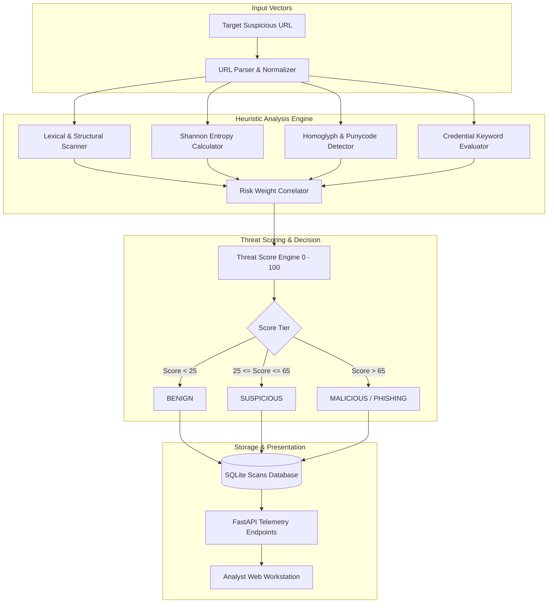

# PhishDetect — Suspicious URL & Anti-Phishing Threat Intelligence Engine

[](https://github.com/Soulofghost/phishdetect/actions)
[](LICENSE)
[](https://www.python.org/)
[](https://fastapi.tiangolo.com/)

PhishDetect is an advanced lexical, structural, and heuristic threat intelligence engine designed to detect spear-phishing campaigns, Internationalized Domain Name (IDN) homoglyph spoofing, credential harvesting parameters, and Domain Generation Algorithm (DGA) entropy anomalies.

---

## 1. Project Introduction

PhishDetect empowers security operations centers (SOC), email security gateways, and corporate threat researchers with instant, non-invasive threat scoring for suspicious URLs. By combining Shannon entropy analysis, multi-script Unicode confusable mapping, targeted brand impersonation heuristics, and TLD reputation scoring, PhishDetect classifies target URLs into actionable risk tiers (`BENIGN`, `SUSPICIOUS`, `MALICIOUS`).

---

## 2. Problem Statement

Adversaries continuously evolve deceptive techniques to bypass static domain reputation blocklists:
- **Homoglyph & Punycode Deception:** Attackers register visually identical Unicode domains (e.g. replacing Latin 'a' with Cyrillic 'а') that evade visual user inspection and basic string matching.
- **Brand Impersonation & Typosquatting:** Attackers embed trusted brand keywords (e.g., `paypal`, `apple`, `microsoft`) inside deceptive subdomains or hyphens.
- **Dynamic DGA Generation:** High-entropy randomly generated hostnames circumvent standard static reputation feeds.
- **Obfuscated Credential Harvesters:** Parameter paths mimic authentic corporate authentication portals to harvest enterprise tokens and passwords.

---

## 3. Proposed Solution

PhishDetect provides an automated, multi-tiered defensive evaluation pipeline:
1. **Mathematical Shannon Entropy Analysis:** Calculates character distribution entropy $H = -\sum p(x) \log_2 p(x)$ on the domain body to immediately flag DGA and obfuscated hostnames.
2. **Punycode & Confusable Detection:** Inspects IDN encodings and cross-checks characters against Cyrillic and Greek Unicode confusable databases to identify lookalike spoofs.
3. **Lexical & Path Heuristics:** Evaluates IP hostnames, excessive subdomain depth, '@' symbol deception, high-risk TLDs, and authentication harvesting keyword patterns.
4. **Weighted Threat Scoring:** Normalizes multi-vector penalties into an intuitive threat score (0–100) with full transparency into triggered risk rules.

---

## 4. Key Features

- **Shannon Entropy Profiler:** Identifies high-entropy algorithmic domain names (> 3.8 bits/symbol).
- **Homoglyph & Punycode Decoupling:** Detects Cyrillic and Greek lookalike characters designed to spoof trusted brands.
- **Brand Impersonation Sentinel:** Flags unauthorized domains incorporating high-value financial and corporate keywords.
- **Credential Keyword Extraction:** Identifies authentication tokens and harvesting parameters in URL paths.
- **Custom Pattern Blocklist:** Create, manage, and enforce organization-specific threat rules.
- **Interactive Security Analyst UI:** Real-time URL inspector with preconfigured attack scenario injections (PayPal lure, Punycode apple, DGA domain, IP trap).

---

## 5. Architecture Diagram



---

## 6. Technology Stack

- **Backend:** Python 3.11+, FastAPI, Pydantic v2
- **Heuristic Core:** Mathematical Shannon Entropy, Unicode Confusable Character Mapping, Regular Expressions
- **Database:** SQLite with Write-Ahead Logging (WAL)
- **Frontend:** Vanilla ES6+ JavaScript, CSS3 with JetBrains Mono and Space Grotesk
- **DevOps:** Docker, Docker Compose, GitHub Actions CI
- **Testing:** Pytest, HTTPX TestClient

---

## 7. Folder Structure

```
phishdetect/
├── .github/
│   └── workflows/
│       └── ci.yml
├── backend/
│   ├── app/
│   │   ├── engine/
│   │   │   ├── __init__.py
│   │   │   └── detector.py
│   │   ├── routers/
│   │   │   ├── __init__.py
│   │   │   ├── blocklist.py
│   │   │   └── inspector.py
│   │   ├── __init__.py
│   │   ├── config.py
│   │   ├── database.py
│   │   ├── main.py
│   │   └── schemas.py
│   ├── tests/
│   │   ├── __init__.py
│   │   ├── test_api.py
│   │   └── test_heuristics.py
│   └── requirements.txt
├── frontend/
│   ├── app.js
│   ├── index.html
│   └── style.css
├── .env.example
├── .gitignore
├── Dockerfile
├── docker-compose.yml
├── LICENSE
└── README.md
```

---

## 8. Installation Instructions

### Prerequisites
- Python 3.11 or later
- Git

### Local Setup
```bash
# Clone the repository
git clone https://github.com/Soulofghost/phishdetect.git
cd phishdetect

# Create and activate virtual environment
python -m venv venv
source venv/bin/activate  # On Windows: .\venv\Scripts\activate

# Install dependencies
pip install -r backend/requirements.txt
```

---

## 9. Environment Configuration

Copy `.env.example` to `.env`:
```bash
cp .env.example .env
```

| Variable | Default | Description |
|---|---|---|
| `PORT` | `8000` | Application HTTP port |
| `PHISHDETECT_DB` | `phishdetect.db` | SQLite database file location |
| `DEFENSIVE_SCOPE` | `AUTHORIZED_ANALYSIS_ONLY` | Safety governance policy flag |

---

## 10. Database Setup

The database schema and initial blocklist seed data initialize automatically on application startup. To inspect or reset the schema:
```bash
python -c "from app.database import init_db; init_db()"
```

---

## 11. API Documentation

### Key Endpoints

| Method | Endpoint | Description |
|---|---|---|
| `GET` | `/api/v1/health` | Health check and active heuristics list |
| `POST` | `/api/v1/inspect` | Inspect target URL and compute threat score |
| `GET` | `/api/v1/inspect/history` | Retrieve historical URL analysis logs |
| `GET` | `/api/v1/inspect/summary` | Aggregate threat intelligence metrics |
| `GET` | `/api/v1/blocklist` | List custom blocklist threat rules |
| `POST` | `/api/v1/blocklist` | Create a custom blocklist pattern |
| `DELETE` | `/api/v1/blocklist/{id}` | Delete a blocklist pattern rule |

---

## 12. Screenshots / Interface Walkthrough

- **Threat Telemetry Gauge:** Circular threat score visualization with dynamic status color rendering.
- **Risk Factor Breakdown:** Granular listing of triggered heuristics, including assigned penalty weights and diagnostic notes.
- **Lexical Metric Badges:** Real-time display of Shannon entropy, TLD status, URL length, and homoglyph detection flags.
- **Simulation Bar:** One-click sample injector for validating detection mechanisms across credential harvesting, IDN spoofs, and DGA links.

---

## 13. Testing Instructions

Run the automated test suite covering entropy mathematics, homoglyph detection, and REST API routes:
```bash
cd backend
pytest tests/ -v
```

Expected output:
```
tests/test_api.py::test_health_check PASSED
tests/test_api.py::test_inspect_urls_api PASSED
tests/test_api.py::test_scan_history_and_summary PASSED
tests/test_api.py::test_blocklist_crud PASSED
tests/test_heuristics.py::test_shannon_entropy PASSED
tests/test_heuristics.py::test_homoglyph_detection PASSED
tests/test_heuristics.py::test_analyze_malicious_phishing_url PASSED
tests/test_heuristics.py::test_analyze_benign_url PASSED
```

---

## 14. Security Considerations

- **Non-Invasive Inspection:** PhishDetect does not execute client JavaScript or connect directly to hostile hosts during lexical parsing.
- **Safe Evaluation:** Designed for defensive email filtering, proxy gateway auditing, and corporate endpoint telemetry.
- **Input Sanitization:** URL parsing is strictly isolated within safe URL decomposition models.

---

## 15. Deployment Instructions

### Docker Deployment
```bash
docker-compose up --build -d
```
Access the application at `http://localhost:8000`.

---

## 16. Known Limitations

- **Heuristic Lexical Model:** Brand impersonation relies on curated high-profile targeted corporate entities.
- **Offline WHOIS:** In strictly offline sandboxes, domain registration age is derived from client-provided headers or simulated telemetry.

---

## 17. Future Roadmap

- [ ] Real-time TLS certificate transparency log monitor.
- [ ] Visual DOM screenshot similarity comparison using lightweight perceptual hashing.
- [ ] Threat feed integration with URLhaus and PhishTank.
- [ ] Browser extension companion for instant client-side threat blocking.

---

## 18. License

Distributed under the MIT License. See [LICENSE](LICENSE) for details.
